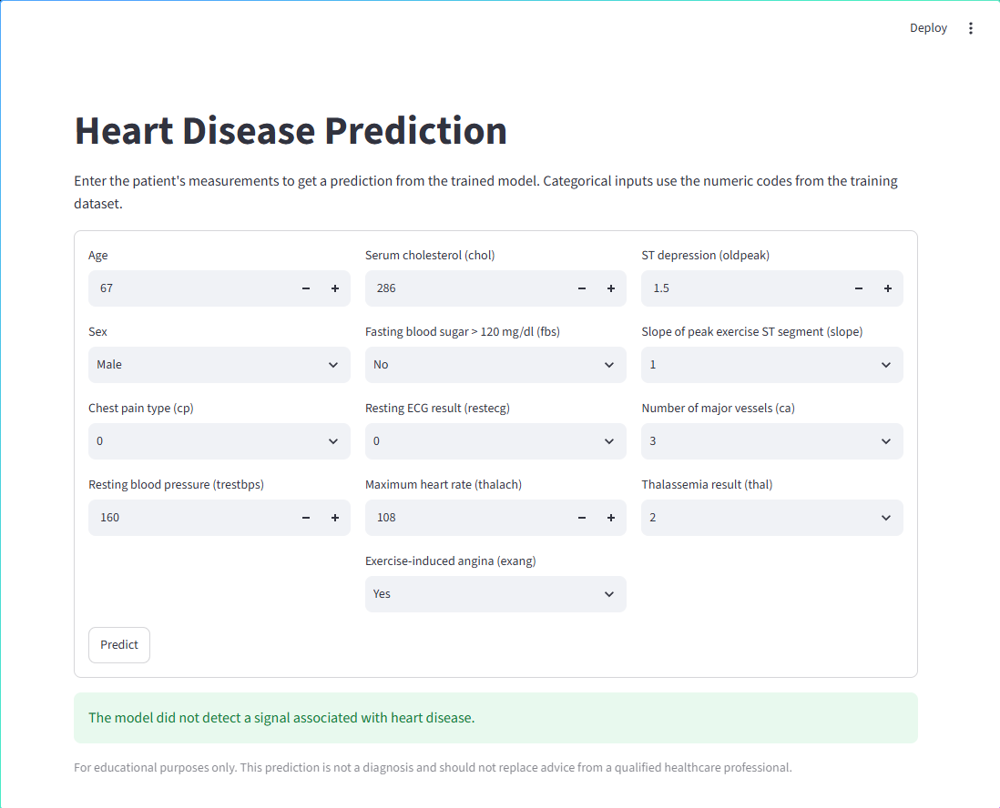
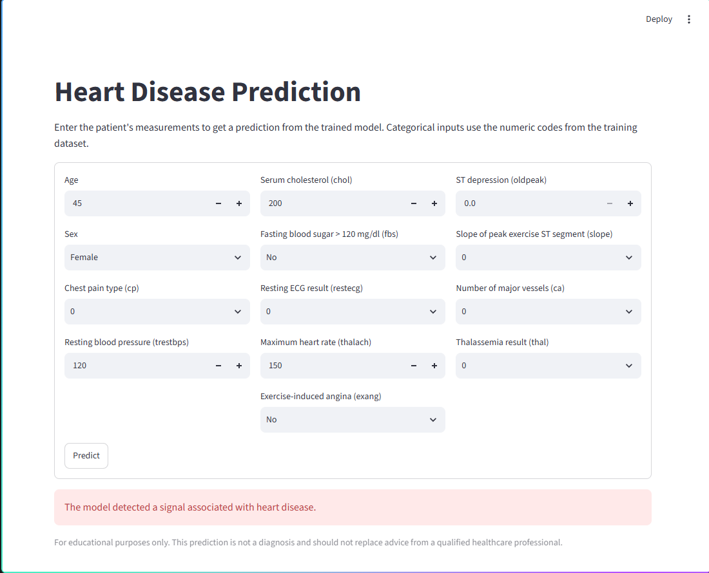

# Heart Disease Prediction

A Streamlit application that loads a trained Logistic Regression model and predicts whether the supplied measurements contain a signal associated with heart disease.

> **Important:** This project is for educational purposes only. Its output is not a diagnosis and must not replace advice from a qualified healthcare professional.

## App Preview

Example with no signal detected:



Example with a signal detected:



## Run the App

Use Python with the dependencies below. The saved model was created with scikit-learn 1.6.1; using the same version avoids model compatibility warnings.

```powershell
py -m venv .venv
.venv\Scripts\Activate.ps1
python -m pip install --upgrade pip
python -m pip install streamlit scikit-learn==1.6.1
python -m streamlit run Model_Use_Case_Application/app.py
```

## Input Features

The app sends values to the model in this order:

1. `age`
2. `sex` (0 = female, 1 = male)
3. `cp` (chest pain type code)
4. `trestbps` (resting blood pressure)
5. `chol` (serum cholesterol)
6. `fbs` (fasting blood sugar over 120 mg/dl: 0 = no, 1 = yes)
7. `restecg` (resting ECG code)
8. `thalach` (maximum heart rate)
9. `exang` (exercise-induced angina: 0 = no, 1 = yes)
10. `oldpeak` (ST depression)
11. `slope` (peak exercise ST segment code)
12. `ca` (number of major vessels)
13. `thal` (thalassemia code)

The model returns class `1` for a signal associated with heart disease and class `0` when it does not detect that signal. A result of `0` does not rule out heart disease.

## Project Structure

```text
Dataset/heart_disease_data.csv
Jupiter_Notebook/heart_disease_detection_machine_learning_model.ipynb
Model_Use_Case_Application/app.py
Our_Trained_Model/heart_disease_model.sav
pictures_for_readmefile/
```